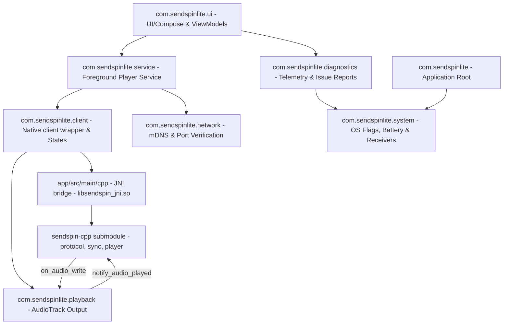

# Sendspin Android player architecture

SendspinLite uses Kotlin for the Android service, UI, and audio output, and sendspin-cpp for the protocol and playback scheduler.

The timing equations and historical sections below came from the former Kotlin client and need a factual review against the native implementation. The offset formula also uses a different sign from the state-vector definition. See [Native client integration](docs/NATIVE_CLIENT.md) for the current integration and its review notes.

## Packages

The app's Kotlin packages use the `com.sendspinlite` namespace. A JNI bridge connects them to the [sendspin-cpp](https://github.com/Sendspin/sendspin-cpp) submodule, which handles the protocol, clock synchronization, and audio scheduling.

### Package dependencies



### Components

- `com.sendspinlite`
  - `SendspinApplication.kt` initializes the app and crash reporting.
- `com.sendspinlite.ui`
  - `MainActivity.kt` displays volume controls, server state, network diagnostics, and logs with Compose.
  - `PlayerViewModel.kt` connects the UI to the playback service.
- `com.sendspinlite.service`
  - `SendspinService.kt` runs playback as a foreground service with a persistent notification. It handles Wi-Fi lock requests and app-volume ramps.
  - `SendspinIntentReceiver.kt` forwards ducking and app-volume broadcasts from external apps. The service registers this exported receiver for its lifetime because modern Android restricts custom implicit broadcasts to manifest receivers.
- `com.sendspinlite.client`
  - `SendspinNativeClient.kt` owns audio output, publishes diagnostics and events, and reports playback progress to native code.
  - `SendspinNative.kt` exposes native lifecycle methods and the `SendspinNativeCallbacks` interface.
  - `ClientState.kt` defines `ClientDiagnostics` and `ClientEvent`.
- `app/src/main/cpp`
  - CMake and the NDK build the JNI bridge as `libsendspin_jni.so`.
  - `jni_onload.cpp` captures the `JavaVM` and attaches native threads to the JVM.
  - `sendspin_client_handle.cpp` owns the native client, roles, listeners, and main-loop thread. `jni_bridge.h` declares the handle and JNI helpers.
  - The Android listeners and network provider forward native callbacks to Kotlin.
- `com.sendspinlite.playback`
  - `PcmAudioOutput.kt` writes PCM to Android's `AudioTrack` and reports presented frames through `getPlaybackProgress()`. It combines the startup ramp, mute, app volume, and duck multiplier into track gain.
  - `PcmFormatSupport.kt` probes sample-rate, channel-count, and bit-depth support.
  - `PlaybackDiagnostics.kt` defines recovery-state constants.
  - `SendspinAudioWarmup.kt` estimates pipeline delay with silent PCM.
- `com.sendspinlite.network`
  - `ServiceDiscovery.kt` resolves `_sendspin-server._tcp.local` servers through Android Network Service Discovery.
  - `PortChecker.kt` checks the server port before connecting.
- `com.sendspinlite.diagnostics`
  - `AudioIssueReporter.kt` collects system diagnostics and redacted playback logs.
  - `CrashReportingManager.kt` and `ReportingUtils.kt` handle crash reports.
- `com.sendspinlite.system`
  - `SendspinSystemUtils.kt` reads network, memory, and media-volume information.
  - `BootReceiver.kt` starts the service after reboot.

## Audio synchronization

The scheduler aligns audio from multiple devices to the server's timestamps.

sendspin-cpp handles WebSocket messages, clock synchronization, decoding, and scheduling. Kotlin writes PCM to AudioTrack and reports playback progress.

```
       [WebSocket frame via IXWebSocket in sendspin-cpp]
               │
               ▼
   [sendspin-cpp protocol + audio ring buffer]
      • Parse messages, extract server timestamps
      • Decode PCM, schedule against the synchronized clock
               │
               ▼  (native sync task thread)
   [JNI on_audio_write] ──► [PcmAudioOutput → AudioTrack]
               ▲                        │
               │                        ▼ getPlaybackProgress()
   [notify_audio_played] ◄── frames presented + finish timestamp
```

### Clock synchronization notes

The time filter translates server timestamps to local time. It uses four NTP-style timestamps and a two-dimensional Kalman filter for clock offset and drift.

#### Offset and delay
Each sync transaction exchanges four timestamps:
- $T_1$: Client transmitted request time.
- $T_2$: Server received request time.
- $T_3$: Server transmitted response time.
- $T_4$: Client received response time.

$$\text{NTP Offset (Measurement)} = \frac{(T_1 - T_2) + (T_4 - T_3)}{2}$$

$$\text{Max Error (Half RTT)} = \frac{(T_4 - T_1) - (T_3 - T_2)}{2}$$

#### Filter state
The Kalman filter tracks the state vector $x_k = \begin{bmatrix} \theta_k & \delta_k \end{bmatrix}^T$ where:
- $\theta_k$: Monotonic clock offset (Server Time - Client Time) in microseconds.
- $\delta_k$: Monotonic clock drift (rate of change of offset, dimensionless in $\mu s/\mu s$).

#### Prediction
At step $k$ with elapsed microsecond time $dt = t_k - t_{k-1}$:

$$\hat{x}_{k|k-1} = F x_{k-1|k-1} \implies \begin{bmatrix} \hat{\theta}_k \\ \hat{\delta}_k \end{bmatrix} = \begin{bmatrix} 1 & dt \\ 0 & 1 \end{bmatrix} \begin{bmatrix} \theta_{k-1} \\ \delta_{k-1} \end{bmatrix}$$

$$P_{k|k-1} = F P_{k-1|k-1} F^T + Q$$

Here, $P$ is the $2 \times 2$ covariance matrix. The process noise matrix $Q$ depends on elapsed time, process variance $\sigma_w^2$, and drift variance $\sigma_d^2$:

$$Q = \begin{bmatrix} dt \cdot \sigma_w^2 & 0 \\ 0 & dt \cdot \sigma_d^2 \end{bmatrix}$$

#### Correction
Using NTP offset $z_k$ as measurement and measurement variance $R_k$ derived from delay max-error:

$$\text{Residual (Innovation)} = y_k = z_k - H \hat{x}_{k|k-1} \implies y_k = z_k - \hat{\theta}_k$$

$$\text{Uncertainty Covariance} = S_k = H P_{k|k-1} H^T + R_k \implies S_k = P_{\theta\theta} + R_k$$

$$\text{Kalman Gain} = K_k = P_{k|k-1} H^T S_k^{-1} \implies K_k = \frac{1}{S_k} \begin{bmatrix} P_{\theta\theta} \\ P_{\theta\delta} \end{bmatrix}$$

$$\text{Updated State} = x_{k|k} = \hat{x}_{k|k-1} + K_k y_k$$

$$\text{Updated Covariance} = P_{k|k} = (I - K_k H) P_{k|k-1}$$

#### Adaptive forgetting
When the residual $|y_k|$ exceeds $3 \times \text{max\_error}$, the filter increases covariance with a forgetting factor. This gives new measurements more weight.

### Historical playout-offset model

The following offset and deadline calculations describe the former Kotlin scheduler. The native scheduler uses playback feedback and sample corrections instead.

#### Playout offset
The historical model combines these offsets:
- A baseline playout offset of approximately $-50\text{ms}$ for Android's pipeline latency.
- A per-device adjustment of $\pm 100\text{ms}$.
- Static delay, $static\_delay\_ms$, for external speaker or amplifier latency.

$$\text{Total Playout Offset } (\mu s) = \text{PlayoutOffset} + \text{PlayoutOffsetAdjustment} - \text{StaticDelay}$$

$$\text{Client Target Time } (T_{play}) = \text{convertServerToClient}(T_{server\_timestamp}) + \text{Total Playout Offset}$$

#### Lateness
The scheduler computes the early playout offset $E$:

$$E = T_{play} - t_{now}$$

- If $E > \text{AudioTrack Latency}$, the thread waits for the difference.
- If $E < \text{AudioTrack Latency}$, the frame is late. Frames beyond the late-drop threshold are discarded.

### Historical speed control

The former Kotlin client used `PlaybackSpeedController` to adjust playback speed. The native integration no longer uses that controller or the `playbackSpeedMultiplier` diagnostic.

The controller changed AudioTrack's playback rate to correct drift.

1. Estimate buffer-ahead depth $B_{ms}$ with an exponential moving average.
2. Calculate error against the $80\text{ms}$ target:

$$e_k = B_{ms} - \text{TargetBufferDepth}$$

3. Calculate the proportional rate adjustment:

$$\text{Adjustment} = e_k \times K_p$$

- If $e_k > 0$, speed increases by up to $1.5\%$.
- If $e_k < 0$, speed decreases by up to $1.5\%$.
- If $|e_k| < 5\text{ms}$, speed stays at $1.0\times$.

## Historical protocol flow

This diagram predates the current spec and the controller-role integration. See [Spec conformance](docs/SPEC_CONFORMANCE.md) for the checklist's review status.

```
[Client]                                                          [Server]
   │                                                                 │
   ├─────── client/hello (Supported roles: player@v1) ──────────────>│
   │                                                                 │
   │<────── server/hello (Active roles: player@v1, metadata) ────────┤
   │                                                                 │
   │   ┌────────────────────────────────────────────────────────┐    │
   │   │ Start continuous Clock Sync & Watchdog Loop            │    │
   │   └────────────────────────────────────────────────────────┘    │
   │                                                                 │
   ├─────── client/state (synchronized, player: delay/vol) ─────────>│
   │                                                                 │
   │   ┌─── LOOP: Sync Timings ─────────────────────────────────┐    │
   ├───│─── client/time (client_transmitted) ──────────────────>│    │
   │   │                                                        │    │
   │   │<── server/time (T1, T2, T3) ───────────────────────────│────┤
   │   └────────────────────────────────────────────────────────┘    │
   │                                                                 │
   │<────── stream/start (PCM codec details, sample rate, play_at) ──┤
   │                                                                 │
   │<────── Binary Chunk Type 4 (Audio data payload) ───────────────┤
   │                                                                 │
   │<────── server/state (Group metadata, volume, muted) ───────────┤
   │                                                                 │
   ├─────── client/goodbye (reason: shutdown / another_server) ─────>│
```

## Build and verification

### Toolchain

Use JDK 17, the repository's Gradle wrapper, NDK `27.0.12077973`, and CMake `3.22.1`. Check [app/build.gradle.kts](app/build.gradle.kts) for Android SDK versions. Earlier versions of this document listed API 31 and SDK 34, which no longer match the build.

Initialize the submodules before building:

```bash
git submodule update --init --recursive
```

### Build commands

These commands select JDK 17 explicitly. Adjust the path for your system:

```bash
# Compile Kotlin sources
./gradlew compileDebugKotlin --no-configuration-cache -Dorg.gradle.java.home=/usr/lib/jvm/java-17-openjdk

# Compile unit tests
./gradlew compileDebugUnitTestKotlin --no-configuration-cache -Dorg.gradle.java.home=/usr/lib/jvm/java-17-openjdk

# Build the debug APK
./gradlew assembleDebug --no-configuration-cache -Dorg.gradle.java.home=/usr/lib/jvm/java-17-openjdk
```

### Unit tests

Unit tests use JUnit and Google Truth.

```bash
# Run the test suite
./gradlew test --no-configuration-cache -Dorg.gradle.java.home=/usr/lib/jvm/java-17-openjdk
```

### Diagnostics

When Sentry reporting is enabled, the app uploads unhandled exceptions and ANR reports. Use the bug-report icon to save an audio diagnostics report.

An earlier version of this document described a five-tap log export from the app title. That instruction needs verification against the current UI.
