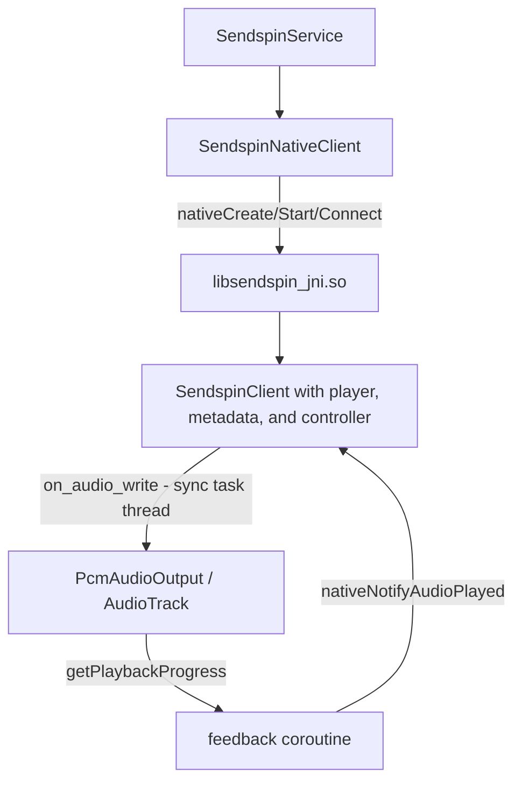

# Native client integration

The [sendspin-cpp](https://github.com/Sendspin/sendspin-cpp) library handles the protocol,
clock synchronization, and audio scheduling. Kotlin handles the foreground service, mDNS
discovery, Compose UI, AudioTrack output, and diagnostics.

## Build the native client

Initialize the submodules before building. Git pins sendspin-cpp to a specific commit:

```bash
git submodule update --init --recursive
```

Install the toolchain through the Android SDK manager. Versions are set in
[`app/build.gradle.kts`](../app/build.gradle.kts):

- NDK `27.0.12077973`, with 16 KB linker flags in CMake
- CMake `3.22.1`

Build the app. Gradle's `externalNativeBuild` compiles the JNI bridge:

```bash
./gradlew assembleDebug
```

The build produces `libsendspin_jni.so` for `arm64-v8a`, `armeabi-v7a`, and `x86_64`.
CMake downloads ArduinoJson, micro-flac, micro-opus, and IXWebSocket through `FetchContent`.
The first configure and CI builds need network access.

### Verify 16 KB page alignment

Google Play requires 16 KB ELF alignment for native libraries on 64-bit devices targeting
Android 15 or later. NDK r28 and later use this alignment by default. This project uses NDK r27
and sets these linker flags in [`CMakeLists.txt`](../app/src/main/cpp/CMakeLists.txt):

```
-Wl,-z,max-page-size=16384
-Wl,-z,common-page-size=16384
```

After building, verify alignment with:

```bash
zipalign -c -P 16 -v 4 app/build/outputs/apk/debug/app-debug.apk
```

On a 16 KB test device or emulator, `adb shell getconf PAGE_SIZE` returns `16384`.

## Build layout

[`CMakeLists.txt`](../app/src/main/cpp/CMakeLists.txt) builds the submodule with the player,
metadata, and controller roles enabled. It links the static `sendspin` library into
`libsendspin_jni.so`. The other roles, examples, and native tests are disabled for the app build.
IXWebSocket uses cleartext `ws://` transport, with TLS and zlib disabled.

| File | Responsibility |
|------|----------------|
| `jni_onload.cpp` | Captures the `JavaVM` and manages native-thread attachment. |
| `sendspin_client_handle.cpp` and `jni_bridge.h` | Own the native client, roles, listeners, and main-loop thread, and define the JNI entry points. |
| `android_player_listener.cpp` | Forwards PCM writes and player events to Kotlin. |
| `android_metadata_listener.cpp` | Forwards track metadata to Kotlin. |
| `android_controller_listener.cpp` | Forwards controller state to Kotlin. |
| `android_client_listener.cpp` | Forwards group updates, clock uncertainty, and high-performance requests. |
| `android_network_provider.cpp` | Asks Kotlin whether the network is ready. |

On the Kotlin side, [`SendspinNative.kt`](../app/src/main/java/com/sendspinlite/client/SendspinNative.kt)
is the JNI loader and [`SendspinNativeClient.kt`](../app/src/main/java/com/sendspinlite/client/SendspinNativeClient.kt)
is the wrapper the service uses.

## Threading and audio flow



- `ClientHandle` owns a main-loop thread that calls `client.loop()` about every 10 ms.
  It delivers non-audio callbacks for metadata, controller state, group state, volume, mute,
  static delay, clock synchronization, high-performance requests, and connection state.
- The native sync thread calls `on_audio_write`. The bridge exposes the PCM buffer to Kotlin
  as a direct `ByteBuffer`. `PcmAudioOutput.writePcm` retries non-blocking AudioTrack writes
  within the supplied timeout.
- A Kotlin feedback coroutine polls `PcmAudioOutput.getPlaybackProgress()` about every 5 ms and calls
  `notify_audio_played(frames, finishTimestampUs)`.

### Clock domain

sendspin-cpp uses `std::chrono::steady_clock`, which uses `CLOCK_MONOTONIC` on Android.
`AudioTimestamp.nanoTime` and `System.nanoTime()` use the same clock domain. The feedback loop
passes a native monotonic timestamp to `getPlaybackProgress()`.

`SystemClock.elapsedRealtimeNanos()` uses `CLOCK_BOOTTIME`, which includes time spent asleep.
It cannot be substituted for the monotonic timestamp in playback feedback.

### Native-thread attachment

`GetEnv()` attaches a native thread when it first calls Kotlin. A `thread_local` guard in
`jni_onload.cpp` detaches the thread at exit. The handle retains the Kotlin callbacks object
with a JNI global reference until destruction.

## Configuration

`nativeCreate` advertises stereo PCM at 48000 and 44100 Hz with 16-bit, 24-bit, and 32-bit samples.
[`AppMemoryPolicy`](../app/src/main/java/com/sendspinlite/system/AppMemoryPolicy.kt) sets ring-buffer
capacity to 2,000,000 bytes by default or 384,000 bytes for lean devices.

Playback feedback accounts for pipeline delay. `update_static_delay` applies the server-adjustable
static delay.

## Diagnostics

The native integration changes the meaning and availability of some diagnostics:

- `playbackSpeedMultiplier` was removed. Native synchronization corrects PCM samples and inserts silence without adjusting AudioTrack's playback speed.
- `forceResyncActive`, `lateRestartLoops`, `audibleSyncCount`, `kalmanErrorCount`, and `lateDrops` do not expose the native scheduler's internal state.
- `playbackRecoveryStatus` reports Android output recovery and starvation events.
- `offsetUncertaintyUs` comes from the native `on_time_sync_updated` callback.
- `smoothedLatencyMs` comes from AudioTrack's pipeline estimate.
- `bufferAheadMs` measures AudioTrack frames written but not yet presented. `queuedChunks` estimates that duration in nominal 20 ms chunks. These are not native ring-buffer measurements.

## Integration limits

- `setPlayoutOffsetAdjustmentMs` logs the request but does not apply it. sendspin-cpp has no runtime setter for fixed pipeline delay.
- Memory-trim callbacks clear Kotlin diagnostics and can pause output on critical pressure. They cannot resize the native ring buffer, whose capacity is fixed at creation.
- The service acquires and releases `WifiManager.WifiLock` in response to native high-performance requests.

## Documentation follow-up

The earlier documentation described player and metadata roles only, a fixed 2 MB buffer, and inactive memory-trim callbacks. The sections above now describe the current bridge and memory policy.

These timing and conformance descriptions still need a separate factual review:

- The historical equations in [Architecture](../ARCH.md) mix clock-offset sign conventions.
- The old feature list described automatic speed adjustment and native diagnostics that the current wrapper does not expose.
- `rttUs` currently equals twice the native clock uncertainty. That value is not a measured round-trip time.
- [Spec conformance](SPEC_CONFORMANCE.md) records an older protocol review. Its statuses are not a current conformance assessment.
